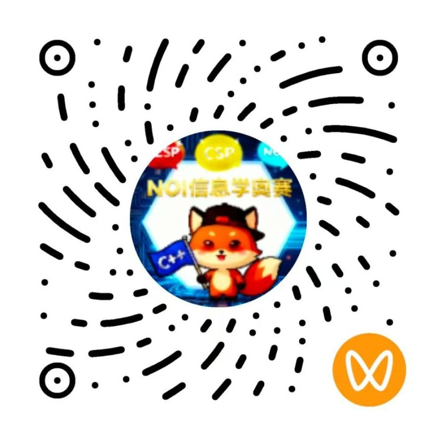
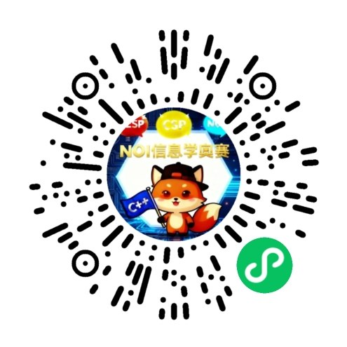

# 信奥教练 使用说明

> 适用版本：dsh-oi-coach **1.0.8** ｜ 面向：家长、学生、教练/老师
> 安装与配置（含 ima、g++）请看 [README.md](./README.md)；本文件只讲**怎么用**。

---

## 一、这是什么

装在 DeepSeek Harness 里的**信奥陪练教练**：它不直接给答案，而是用提问带着孩子把题想明白、把代码调通，
并把每一轮的学习痕迹自动归档到自己的 ima 笔记本——陪练、评测、错题复习一条龙。

覆盖 **GESP、CSP-J/S、NOIP、省选、NOI** 五个阶段，内置 80+ 知识点的分级课程大纲。

## 二、它能做什么

| 模块 | 你可以这样说 | 教练会做什么 |
| --- | --- | --- |
| 学习规划与备考节奏 | "帮孩子制定一份到 CSP-J 的计划，每周只有 3 小时" | 按分级大纲给知识点清单、周数、总周期；错题优先排进计划 |
| 知识点讲解 | "给孩子讲一下线段树" / "前缀和是什么" | 定位级别与前置知识，用生活化类比讲：概念 → 复杂度 → 手算例子 → 常见错误 → 练习题 |
| 真题拆解 | "这题怎么写？" | **分步提问引导**（题意 → 建模 → 解法 → 验证），不一次性给答案 |
| 代码评测与纠错 | 贴代码 + 测试数据 | 真编译真运行，逐测试点判定 AC/WA/TLE/RE；**一次只指出第一处错误**，引导孩子自己修 |
| 错题复盘与错题本 | "这道题错了，帮我记一下" | 按错题模板整理（现象/类型/卡点/正确思路/复盘问答/知识点/复习日期）并归档 |
| 学习追踪与报告 | "生成本月学习报告" | 计划、完成情况、新错题、待复习清单、后续建议 |
| 资料调阅 | "按我订阅的知识库回答逆序对怎么求" | 检索你的 ima 知识库，如实列出**实际检索过的库名** |

## 三、启用（三步）

1. **启动**（在 dsh 仓库根目录）：
   ```powershell
   pnpm dsh web --patch ./dsh-oi-coach/cordis.yml
   ```
2. **自检**：对孩子/家长说「先用 xinao_doctor 自检一下」→ 会报告 g++ 是否可用、ima 是否连通、4 个归档笔记本是否就绪。
3. **出问题时**：按自检输出的提示修（没装 g++ 会给出分平台安装指引；ima 未配置会给出接入手册位置）。

> ima 是**可选增强**：不配也能正常陪练，只是不查库、不归档，并会如实标注"未查询/归档跳过"。

## 四、快速上手：三个开场白

```
① 规划：  孩子五年级，想学信奥，帮他规划一条入门路线（还没过 GESP 一级）
② 讲解：  给孩子讲一下二分答案，他刚学完循环和数组
③ 纠错：  用 xinao_judge 评测这段代码，测试数据是：输入 5 期望 120；输入 3 期望 6
          （然后贴孩子的代码）
```

## 五、实战场景

### 场景 1：接 ima 知识库查资料（**优先检索** + 透明标注）

**凡是信奥相关的问题（知识点、真题、纠错、规划），教练会先查你的 ima 知识库再作答**，
而不是默认凭记忆直答；纯问候/闲聊才不查。

你问："按我订阅的知识库回答：逆序对有哪些求法？"

教练回复开头会带**透明标记**，三种状态之一：

| 标记 | 含义 |
| --- | --- |
| `[IMA知识库：未查询]` | 纯问候/闲聊，或知识库没连上（会补一句原因） |
| `[IMA知识库：已查询，未使用]` | 查了，但知识库内容没帮上忙（会列出实际检索的库名） |
| `[IMA知识库：已查询，已使用]` | 用了知识库内容作答（引用忠于原文，不编造文档名） |

看到 `[IMA知识库：未查询]` 就说明**这轮没有走知识库**——它只会说真话，不会假装查过。

### 场景 2：代码评测与纠错（**不直接给答案，带着孩子把 bug 找到**）

把孩子的代码和测试数据一起发过去，教练会：

1. **真实编译运行**（C++14），逐测试点判定；
2. 编译错误时给出**第一条错误**（不是一大片报错），例如：
   ```
   第一条错误（教学提示：一次只指出这一处，让学生自己改）：
   main.cpp:5:9: error: 'cout' was not declared in this scope
   ```
3. WA 时给出**期望 vs 实际**的差异，然后**提问引导**孩子自己想：
   - "拿 n=1 试试，你的程序会输出什么？"
   - "这行循环每次在做什么？"
   - "边界条件你考虑了几个？"
4. 只有孩子多次尝试仍卡住、或明确要求"直接给代码"，才给完整修正版。

**家长/老师请配合这一点**：孩子改完**第一处**再发下一轮，不要一次把所有问题都抛给他——信息过载会剥夺思考机会。

### 场景 3：错题复习

当某道题「未 AC / 需巩固」时，让教练按错题模板整理并归档到 **信奥教练-错题本**：

| 字段 | 说明 |
| --- | --- |
| 日期 / 题号来源 | 洛谷 ID、真题年份等 |
| 错误现象 | WA / TLE / RE / CE / 没思路 |
| 错误类型 | 理解偏差 / 逻辑错误 / 实现 bug / 效率 TLE / 边界遗漏 |
| 卡点记录 | 孩子的关键误区或原话 |
| 正确思路 | **引导孩子自己说出来的版本** |
| 复盘提问答案 | 三问：用哪招？为什么卡？下次怎么认出来？ |
| 所属知识点 | 含分级（如 提高组-线段树） |
| 待复习标记 | 是/否 + 建议复习日期 |

复习时直接说：「把错题本里待复习的题拿出来，挑 3 道考他」——教练会据此安排，而不是凭空出新题。

### 场景 4：计划与报告分开归档

- 产出**周/月备考计划** → 归档到 `信奥教练-学习计划`
- 产出**阶段测试 / 模拟考报告** → 归档到 `信奥教练-学习报告`
- **每轮问答** → 归档到 `信奥教练-学习档案`

> 每条归档笔记的**最下边**会自动追加「推荐关注 + 四个渠道二维码」，
> 四个二维码**一行展示、两两间隔 60px**（每张 120×120），方便家长和孩子在笔记里直接扫码关注。
>
> 同样地，**对话回复的最末尾也会固定带这个小节**（`[归档：…]` 状态行在小节之前，让二维码收尾）。

## 六、陪练规矩

**给孩子的三条规矩**（教练会自然讲清，不说教）：

1. **答案只作参考，不能照抄**——抄了等于没学；
2. **AI 也会出错，必须自己验证**——跑一遍、举反例或对拍确认；
3. **保护隐私**——不说真实姓名、学校、住址、电话，代码注释里也别写。

**教练的纪律**：一次只讲一处错误；先让孩子讲思路再给代码；不编造真题年份、题号、数据范围或知识库文档名；拿不准就如实说。

## 七、透明标记与归档状态行

- 回复最前面：`[信奥教练：已调用]` + `[IMA知识库：…]`
- 回复末尾：`[归档：成功 note_id=… 标题=… 笔记本=…]`
  - 失败会写 `[归档：失败 code=… 原因=…]`；没满足前置会写 `[归档：跳过 原因=…]`
  - **归档是动作不是描述**：没写成成功就是没成功，不会假装。

## 八、常见问题

**Q：不知道怎么用 / 第一次上手？**
直接在对话里说「**我不会用 / 怎么用**」——教练会给出三步上手路径，并附上两篇使用说明文章
（见文末"相关文章"）。也可以先用 `xinao_doctor` 自检环境。

**Q：没装 ima 能用吗？**
能。只是不查知识库、不归档，教练会如实标注。

**Q：查库/归档报 `200002 skill auth failed`？**
凭证未授权或过期。到 https://ima.qq.com/agent-interface 重新生成 Client ID / API Key，写入环境变量
`IMA_CLIENT_ID` / `IMA_API_KEY`（或 `~/.config/ima/` 两个文件）后重试。

**Q：评测说"无法启动编译器"？**
本机没装 g++（或路径不对）。按提示装 MinGW-w64（Windows）/ `apt install g++`（Linux）/ `brew install gcc`（macOS），
或把 `judge.compiler` 配成编译器路径。没有编译器时教练会退回人工批改，不会谎称跑过。

**Q：想换归档笔记本名？**
在 ima 客户端建好新名字，然后改配置里的 `ima.notebooks`（archive/mistakes/plan/report）——两者必须严格一致。

**Q：不想显示推荐语？**
配置 `recommend.enabled: false` 即可整体关闭；也可以只改 `recommend.text` 换文案。

**Q：归档的笔记能删吗？**
ima API 不支持删除，请在 ima 客户端手动删。

## 九、家长怎么用（三条建议）

1. **不代写、不给答案**：把孩子的代码原样发过来，让教练去引导；
2. **检查"独立 AC 的题数"**，不是"做了多少题"；
3. **每次只推进一处**：改完第一处错误再发下一轮，养成自己调试的习惯。

## 十、扫码关注与延伸阅读

想学更多信奥知识，**扫码关注**：

**欣泽编程 公众号**


**欣泽编程 视频号**



**欣泽编程-信奥知识大全 知识库**（扫码订阅 ima 知识库）


**信奥编程算法 小程序**



- 相关文章（可适时发给家长/学生参考）：
  - [学习系统和AI工具](https://mp.weixin.qq.com/s/wCZ45tAxpPhkA7z5YpnvMg)
  - [「信奥教练」上线 WorkBuddy 技能市场：接 ima 知识库，陪练评测错题复习全搞定](https://mp.weixin.qq.com/s/wCnaFl_hdgbWMS10qbizCg)
  - [信奥教练错题讲解实战：不直接给答案，带着孩子把 bug 找到](https://mp.weixin.qq.com/s/gJ7AuyBbYIyUTTzLmF9hqw)
  - [「信奥学长」刷题好搭档上线 WorkBuddy：题意拆解、考点梳理、解题思路、易错点、三版代码、真评测带归档](https://mp.weixin.qq.com/s/6xZbOt232HGVZfLxKrzpKA)
